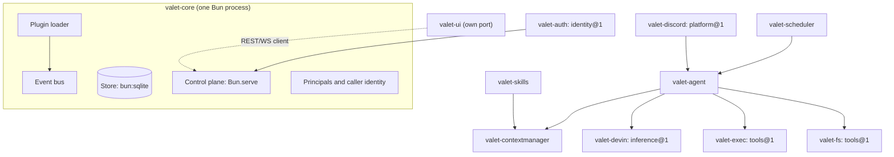

# valet-core architecture

Status: draft 2, with Owner's review folded in (2026-11-12). Repo: `valethq/valet-core`. Plugins: `valethq/valet-<name>`. Runtime: Bun (host runs 1.4.4).

Valet is a plugin-first agent harness. It replaces OpenClaw as the place where Owner's agent (Helper) lives. The core is small. It stores state, routes events, loads plugins and hosts HTTP and WebSocket routes. Everything an agent harness actually does, including the agent loop, is done by plugins through the same public API that any third-party plugin gets.

This document is the contract for that API. Section 14 records Owner's decisions.

**Changes in draft 2:** (1) Every event, hook and scope call carries the caller's plugin identity, and any plugin can deny service. Authentication and authorization are therefore federated to plugins, still through public APIs only (sections 7.2 and 10.2). (2) The core HTTP/WS port is a control plane for valet itself. The web UI runs its own server on its own port (sections 10 and 11.5).

---

## 1. Goals and non-goals

**v1 goals** (in the order of the OpenClaw usage audit, 2026-11-11):

1. Multi-session web chat, with one session per task.
2. Long-running shell exec that streams output, can be interrupted cleanly, and survives a valet restart.
3. Helper's persona and memory files carried over intact: `AGENTS.md`, `USER.md`, `MEMORY.md`, `SOUL.md`, `IDENTITY.md` and `memory/YYYY-MM-DD.md`.
4. Devin CLI as the inference provider, with a per-session model picker and fallbacks.
5. Compaction and resume, including resume after a restart in the middle of a turn.
6. A Discord bot with owner and friend tiers.

**Non-goals for v1:** sandboxing plugins from each other, multi-host or cross-process event delivery, a plugin marketplace, iMessage, voice, the TUI and the iOS app, a full automation platform, and native integrations for the CLIs Helper already drives through the shell (`gog`, `ntn`, Cloudflare, Proxmox).

**Design rules**

- **Core has no agent logic.** It never calls a model, builds a prompt or runs a tool.
- **No private hooks.** Base plugins (`valet-agent`, `valet-ui`, `valet-contextmanager`) get exactly the `PluginContext` any plugin gets. There is no `ctx.internal`. If a base plugin needs something, it becomes public API or it doesn't happen.
- **Core stamps identity; plugins decide whom to serve.** Every event, hook and scope call carries the id of the plugin behind it. Core fills that in and nothing can forge it. Whether to serve a caller is up to the plugin being asked, and it can deny. Authentication is a plugin too (`valet-auth`). Core has no role checks of its own.
- **The core port is a control plane.** HTTP and WS on it exist to control valet. No UI is served there. `valet-ui` runs its own server.
- **Plugins import `@valethq/sdk` only.** The SDK holds types plus a few zero-dependency helpers. Plugins never import `@valethq/core`. A lint rule and a CI test enforce this (section 11).
- **Headless is just "no UI plugin".** The control plane (core REST and WS) still serves. Discord and scheduled jobs still work.
- **Personas, models and prompts are data.** They live on projects and sessions, not in code or plugin config.

## 2. Glossary

| Term | Meaning |
|---|---|
| **Core** | The `valet` process: plugin loader, event bus, store, HTTP/WS host, principals. |
| **Plugin** | A directory with `manifest.json` and an entry module exporting `definePlugin(...)`. It runs in-process. |
| **Scope** | A named, versioned capability contract (a TypeScript interface) that plugins provide and consume, e.g. `inference@1` or `tools@1`. |
| **Project** | A workspace: a directory on disk plus defaults (persona, model, settings). Helper is one project. |
| **Session** | One conversation inside a project. It has its own model, color, title and channel bindings. |
| **Message / Part** | A message has a role and an author. Its content is an ordered list of typed parts (text, tool call, tool result, and so on). |
| **Run** | One agent turn in a session: from the trigger to the final assistant message. Runs are persisted so that interruptions can be detected. |
| **Principal** | An actor with a role: `owner`, `trusted` (friend) or `guest`. Platform identities such as a Discord user ID map to principals. |
| **Caller** | Who caused an event, a store write or a scope call: the plugin id (stamped by core), plus the principal it acts for when there is one. |
| **Control plane** | The core HTTP/WS port: the API for controlling valet. It serves no UI. |

## 3. Core vs plugins



| Core owns | Plugins own |
|---|---|
| Loading, ordering, activating and deactivating plugins | The agent loop, run queueing, interrupt and steer policy (`valet-agent`) |
| The event bus and the core event catalog | Prompt building, history windowing, compaction, persona and memory files (`valet-contextmanager`) |
| Persistence of projects, sessions, messages, parts, runs, principals, blobs and plugin KV | Model calls (`valet-devin`, later `valet-openai`) |
| Detecting interrupted runs at boot | Deciding whether to resume them (`valet-agent`) |
| The control-plane HTTP/WS server and route mounting. Stamping caller identity on every event, hook and scope call | Authentication and every allow/deny decision (`valet-auth`, and each plugin for its own service). All UI, on its own port (`valet-ui`) |
| The core REST API and WS topics for core entities | Tools (`valet-exec`, `valet-fs`, `valet-web`) |
| Config and secrets loading | Platforms (`valet-discord`), schedules (`valet-scheduler`), skills (`valet-skills`) |
| Scope registry (provide/consume and cardinality) | Defining new scopes beyond the core set |

Core defines the core scopes' **interfaces** in the SDK (`inference@1`, `tools@1`, `platform@1`, `identity@1`, `context@1`) because several unrelated plugins must agree on them. It never **implements** them. `context@1` is implemented and registered (`defineScope`) by `valet-contextmanager`; core only ships its types. Any plugin can define a scope of its own the same way.

## 4. Repo layout and packages

```
valet-core/
  ARCHITECTURE.md
  packages/
    sdk/          @valethq/sdk   types, definePlugin, defineScope, zero runtime deps
    core/         @valethq/core  kernel and the `valet` CLI (valet start | valet doctor | valet import-openclaw)
  plugins/        base plugins until they split into valethq/valet-<name> (decision 4)
    agent/ auth/ contextmanager/ ui/ devin/ exec/ fs/ discord/ skills/ scheduler/
  test/           kernel tests, including "boots with zero plugins"
```

The npm scope is `@valethq` (not `@valet`) so it matches the org. Bun runs TypeScript directly, so a plugin's `main` can point at a `.ts` file with no build step.

## 5. Plugins

### 5.1 Manifest (`manifest.json`)

```ts
export interface PluginManifest {
  /** Manifest format version. */
  schema: 1;
  /** Globally unique; matches the repo name, e.g. "valet-discord". */
  id: string;
  name: string;
  version: string; // semver
  description?: string;
  /** Semver range of the core plugin API this targets, e.g. "^0.1.0". */
  valet: string;
  /** Entry module, relative to the manifest. Bun loads .ts directly. */
  main: string;
  /** Hard plugin dependencies: id -> semver range. Loaded first; if one is missing or fails, this plugin does not load. */
  dependencies?: Record<string, string>;
  /** Soft plugin dependencies: loaded first when present; absence is fine. */
  optionalDependencies?: Record<string, string>;
  /** Scopes this plugin implements, as "name@major", e.g. ["inference@1"]. */
  provides?: string[];
  /** Scopes this plugin needs at activation, as "name@major". Every provider of a required scope loads first. */
  requires?: string[];
  /** Like `requires`, but the plugin works without them. */
  optionalRequires?: string[];
  /** Event namespace this plugin may emit under. Defaults to the id without the "valet-" prefix. */
  events?: { namespace?: string };
  /** JSON Schema for this plugin's config block; core validates it before activate(). */
  configSchema?: Record<string, unknown>;
  /** Reserved for post-v1 permissions. Ignored in v1 (plugins are fully trusted). */
  permissions?: string[];
}
```

Example:

```json
{
  "schema": 1,
  "id": "valet-discord",
  "name": "Discord",
  "version": "0.1.0",
  "valet": "^0.1.0",
  "main": "./src/index.ts",
  "dependencies": { "valet-agent": "^0.1.0" },
  "provides": ["platform@1"],
  "events": { "namespace": "discord" },
  "configSchema": {
    "type": "object",
    "required": ["tokenSecret", "guildId"],
    "properties": {
      "tokenSecret": { "type": "string" },
      "guildId": { "type": "string" },
      "openChannels": { "type": "array", "items": { "type": "string" } }
    }
  }
}
```

### 5.2 Discovery, resolution and load order

1. **Discover.** Core reads every `*/manifest.json` under each `pluginPaths` entry in config (default `~/.valet/plugins` and the repo's `plugins/`). A plugin listed in `plugins` config as disabled is dropped. Two manifests with the same id is a boot error.
2. **Validate.** Core checks the manifest against the schema and `valet` against the core API version. It validates the plugin's config block against `configSchema`. A failure marks only that plugin `failed`.
3. **Build the graph.** Edges come from `dependencies`, from `optionalDependencies` when present, and from `requires`/`optionalRequires`: for each scope required, an edge runs from every plugin that `provides` it. A missing hard dependency or required scope marks the plugin `failed`, and that cascades to its dependents.
4. **Order.** Core runs a topological sort (Kahn's algorithm), breaking ties by id so boot order is deterministic. Plugins in a cycle are all marked `failed` with the cycle printed. Core does not guess.
5. **Activate** sequentially in that order: `await plugin.activate(ctx)`, with a 15s timeout. A throw or timeout marks the plugin `failed`, disposes anything it registered, and fails its hard dependents. Optional dependents still activate.
6. **Ready.** Once every plugin has settled, core emits `core.ready`. Only then does it emit `run.interrupted` for runs found mid-flight at boot (section 7.4) and start accepting HTTP.
7. **Shutdown** (SIGTERM or `valet stop`): core emits `core.shutdown` and stops accepting requests. It deactivates plugins in reverse order (5s each) and aborts each `ctx.signal`. Then it checkpoints SQLite and exits.

`GET /api/core/plugins` reports each plugin's state (`active | failed | disabled`), error and load order. In v1 a crashed plugin stays down until restart. There is no hot reload.

### 5.3 Plugin entry and context

```ts
export interface ValetPlugin<Config = unknown> {
  activate(ctx: PluginContext<Config>): void | Promise<void>;
  deactivate?(): void | Promise<void>;
}
export declare function definePlugin<Config = unknown>(plugin: ValetPlugin<Config>): ValetPlugin<Config>;

export interface PluginContext<Config = unknown> {
  readonly plugin: { readonly id: string; readonly version: string; readonly dir: string; readonly manifest: PluginManifest };
  readonly config: Config;
  readonly log: Logger;
  readonly events: PluginEventBus;
  readonly scopes: ScopeRegistry;
  readonly store: Store;
  readonly storage: PluginStorage;
  readonly http: HttpHost;
  readonly ws: WsHost;
  readonly secrets: Secrets;
  readonly paths: { readonly data: string; readonly cache: string; readonly valetHome: string };
  /** Aborted when this plugin deactivates or core shuts down. */
  readonly signal: AbortSignal;
  /** Runs on deactivate, in reverse registration order. Hooks, scopes, routes and WS handlers are disposed automatically. */
  onDispose(fn: () => void | Promise<void>): void;
}

export interface Logger {
  debug(msg: string, data?: Record<string, unknown>): void;
  info(msg: string, data?: Record<string, unknown>): void;
  warn(msg: string, data?: Record<string, unknown>): void;
  error(msg: string, data?: Record<string, unknown>): void;
}

export interface Secrets {
  /** Resolves ~/.valet/secrets/<name> (file, mode 0600) and then the environment variable <NAME>. */
  get(name: string): Promise<string | undefined>;
  require(name: string): Promise<string>;
}

export interface Disposable { dispose(): void }
```

Everything a plugin registers through `ctx` is tagged with its id and removed on deactivate. That covers hooks, scope implementations, routes and WS handlers. A plugin can't leak a hook into the bus after it's gone. The same id is what core stamps as `caller.plugin` on everything the plugin emits, writes or calls (section 7.2). Each plugin gets its own `ctx`, and there is no way to act under another plugin's id.

## 6. Scopes

A scope is a contract between plugins. It has an id, a major version and a cardinality:

- **`one`**: a single provider is active (e.g. `context@1`). A second provider is a load error, unless config names the winner.
- **`many`**: any number of keyed providers (e.g. `inference@1` keyed by provider id, `tools@1`, `platform@1`).

Scope types are registered with declaration merging, so `ctx.scopes.get("inference")` is fully typed in any plugin that imports the scope's types:

```ts
export interface ValetScopes {
  inference: InferenceProvider;
  tools: ToolProvider;
  platform: MessagePlatform;
  identity: IdentityProvider;
  context: ContextManager;   // provided by valet-contextmanager
}
export type ScopeName = Extract<keyof ValetScopes, string>;

export interface ScopeDefinition { name: string; version: number; cardinality: "one" | "many" }
export declare function defineScope(def: ScopeDefinition): ScopeDefinition;

export interface ScopeProvider<K extends ScopeName> {
  readonly key: string;     // provider key, e.g. "devin-cli"; defaults to the plugin id
  readonly plugin: string;
  readonly impl: ValetScopes[K];
}

export type ScopeImpl<K extends ScopeName> = ValetScopes[K] | ((caller: Caller) => ValetScopes[K]);

export interface ScopeRegistry {
  define(def: ScopeDefinition): void;
  /** A factory is called once per consuming plugin with that plugin's identity, so the provider knows who is calling. */
  provide<K extends ScopeName>(scope: K, impl: ScopeImpl<K>, opts?: { key?: string }): Disposable;
  /** The single provider (cardinality "one") or the provider with this key. Throws ScopeMissingError. */
  get<K extends ScopeName>(scope: K, key?: string): ValetScopes[K];
  maybe<K extends ScopeName>(scope: K, key?: string): ValetScopes[K] | undefined;
  all<K extends ScopeName>(scope: K): ScopeProvider<K>[];
  /** Fires on provide and dispose, so consumers can track providers that arrive later or go away. */
  watch<K extends ScopeName>(scope: K, fn: (providers: ScopeProvider<K>[]) => void): Disposable;
}
```

A plugin that implements a scope must list it in `provides`, and core rejects an unlisted `provide()`. This keeps the manifest honest, so the loader can order plugins before any code runs.

**Who is calling.** `get`, `maybe` and `all` return the implementation bound to the consuming plugin. A provider that passed a factory sees that plugin's `Caller` and can refuse it, for every call or per call, by throwing `ServiceDeniedError`. Core wraps bound implementations and sets `by` to the provider's id, so a denial is always attributed correctly.

```ts
export declare class ServiceDeniedError extends Error {
  readonly by: string;
  readonly reason: string;
  constructor(reason: string);
}
```

### 6.1 `inference@1`: model providers

The audit found a fact that shapes this interface. OpenClaw's `devin-cli` provider does not use Devin as a stateless model. `~/.openclaw/plugins/devin-cli/sessions.json` maps each of 118 OpenClaw sessions to a persistent Devin CLI session (`devinSessionId`, `cwd` = the workspace, `contextTokens` up to ~600k). Devin runs its own loop, its own tools and its own history. So providers come in two kinds:

- **`model`**: a stateless completion API (an OpenAI-compatible endpoint such as CLIProxyAPI). `valet-agent` runs the tool loop and `valet-contextmanager` owns the history.
- **`agent`**: a delegated agent (Devin CLI over ACP). The provider owns the inner loop, tools and remote history. Valet mirrors the stream into messages and parts, and offers valet's own tools to the agent over MCP.

```ts
export interface ModelInfo {
  id: string;            // "claude-opus-5-5"
  name: string;          // "Claude Opus 5.5"
  contextWindow: number;
  maxOutputTokens: number;
  input: ("text" | "image")[];
  reasoning: boolean;
  cost?: { input: number; output: number; cacheRead?: number }; // per 1M tokens
}

export type InferenceProvider = ModelProvider | AgentProvider;

interface ProviderBase {
  readonly id: string;     // "devin-cli"; also the scope key
  readonly label: string;
  listModels(): Promise<ModelInfo[]>;
  /** The provider's Utility model: a cheap, fast model for small side jobs such as naming a session. */
  readonly utility?: UtilityModel;
}

export interface UtilityRequest { system: string; prompt: string; maxOutputTokens?: number }

export interface UtilityModel {
  /** Id of the model side jobs run on, or undefined when the provider has none to offer. */
  model(): string | undefined;
  /** One short, tool-free completion on `model()`. Rejects when the call fails. */
  complete(req: UtilityRequest, signal: AbortSignal): Promise<string>;
}

// ---- kind: "model" ----
export interface ModelProvider extends ProviderBase {
  readonly kind: "model";
  stream(req: InferenceRequest, signal: AbortSignal): AsyncIterable<InferenceChunk>;
}

export interface InferenceRequest {
  model: string;
  system: string;
  messages: ModelMessage[];
  tools: ToolSpec[];
  maxOutputTokens?: number;
  reasoning?: "off" | "low" | "medium" | "high";
  meta: { sessionId: string; runId: string };
}

export type ModelMessage =
  | { role: "user"; content: ModelContent[] }
  | { role: "assistant"; content: ModelContent[] }
  | { role: "tool"; callId: string; content: ModelContent[]; isError?: boolean };

export type ModelContent =
  | { type: "text"; text: string }
  | { type: "image"; mime: string; blobId: string }
  | { type: "tool-call"; callId: string; name: string; input: unknown };

export type InferenceChunk =
  | { type: "text-delta"; text: string }
  | { type: "reasoning-delta"; text: string }
  | { type: "tool-call"; callId: string; name: string; input: unknown }
  | { type: "usage"; inputTokens: number; outputTokens: number; cacheReadTokens?: number }
  | { type: "finish"; reason: "stop" | "tool-calls" | "length" | "cancelled" | "error"; error?: string };

// ---- kind: "agent" ----
export interface AgentProvider extends ProviderBase {
  readonly kind: "agent";
  /** Opens a new remote session, or reopens one when `resumeId` (from Session.providerState) is given. */
  open(opts: AgentOpenOptions): Promise<AgentSession>;
}

export interface AgentOpenOptions {
  sessionId: string;
  cwd: string;
  model: string;
  resumeId?: string;
  /** Valet's tools for this session (see 6.2). The provider decides how to expose them to its agent. */
  tools: ToolSurface;
  signal: AbortSignal;
}

/** Valet's tools as one provider sees them. Bound to the session: `list` and `call` follow the active run. */
export interface ToolSurface {
  /** Tools this run may use, as of the run's start. Empty when no run is active. */
  list(): ToolSpec[];
  /** Runs one call through the `tool.call` gate, then the tool. A denied or failed call returns `isError`; it never throws. */
  call(name: string, input: unknown, call: { callId: string; signal: AbortSignal }): Promise<ToolResult>;
  /** Runs the `tool.call` gate for a call the provider runs itself (a built-in or native tool). Returns the input to use, or a denial. */
  authorize(name: string, input: unknown, call: { callId: string }): Promise<{ input: unknown } | { denied: string }>;
}

export interface AgentSession {
  /** Persisted on the session so it can be reopened after a restart. */
  readonly resumeId: string;
  prompt(input: { content: ModelContent[]; preamble?: string }, signal: AbortSignal): AsyncIterable<AgentEvent>;
  setModel?(model: string): Promise<void>;
  close(): Promise<void>;
}

export type AgentEvent =
  | { type: "text-delta"; text: string }
  | { type: "reasoning-delta"; text: string }
  | { type: "tool-start"; callId: string; name: string; title?: string; input?: unknown }
  | { type: "tool-update"; callId: string; outputDelta?: string; status?: "running" | "done" | "error" }
  | {
      type: "tool-end";
      callId: string;
      status: "done" | "error" | "cancelled";
      output?: string;
      exitCode?: number;
    }
  | { type: "permission"; request: { callId: string; title: string }; respond(allow: boolean): void }
  | { type: "usage"; contextTokens?: number; inputTokens?: number; outputTokens?: number }
  | { type: "notice"; level: "info" | "warning" | "error"; text: string }
  | { type: "finish"; reason: "stop" | "cancelled" | "length" | "error"; error?: string };
```

Providers set `exitCode` on `tool-end` when the tool reports one; `valet-agent` stores it as the tool part's `result.meta.exitCode`. A `notice` event is out-of-band provider information (e.g. a context-compaction warning), rendered as a `notice` part rather than hidden inside reasoning text.

**Fallbacks** are data, not provider logic. `session.settings.model` is `{ provider, model, fallbacks: [{ provider, model }...] }`. On `finish: error`, or a refusal, before any output has streamed, `valet-agent` retries with the next fallback. For Devin, `valet-devin` also passes `--refusal-fallback`.

### 6.2 `tools@1`: tools

```ts
export type Role = "owner" | "trusted" | "guest";

export interface ToolSpec { name: string; description: string; inputSchema: Record<string, unknown> }

export interface ToolDefinition<Input = unknown> extends ToolSpec {
  /** Lowest role this tool serves (the run's effective role, section 8.3). The providing plugin enforces it: the SDK's `defineTool` applies it in `list` and again in `invoke`. Core and valet-agent do not. Default "owner". */
  minRole?: Role;
  timeoutMs?: number;
  invoke(input: Input, call: ToolCall): Promise<ToolResult>;
}

export interface ToolCall {
  sessionId: string;
  runId: string;
  callId: string;
  role: Role;
  /** Stamped by core: the plugin making the call and the principal behind the run. */
  caller: Caller;
  cwd: string;
  signal: AbortSignal;
  /** Streams partial output to the tool-call part and to WS subscribers. */
  progress(update: { outputDelta?: string; status?: string }): void;
}

export interface ToolResult {
  content: ({ type: "text"; text: string } | { type: "image"; mime: string; blobId: string })[];
  isError?: boolean;
  meta?: Record<string, unknown>;
}

export interface ToolProvider {
  /** Re-read on each run, so tools can depend on session or project. */
  list(scope: { sessionId: string; projectId: string; role: Role }): ToolDefinition[] | Promise<ToolDefinition[]>;
}
```

`valet-agent` collects `scopes.all("tools")` for each run and filters the result by the run's role and by its exposure config. It hands each provider a `ToolSurface` (6.1). The surface runs the `tool.call` event (section 7.3) before every call, so policy plugins can deny or rewrite it. A denial comes back to the provider as an `isError` result. How a provider exposes the surface is the provider's choice. `valet-claudecode` and `valet-devin` mount it as an MCP server on their own route, with a per-session bearer token, through the SDK's `toolEndpoint` helper, and pass that server to their agent. A `model`-kind provider takes the tool specs in its request instead. Either way the calls show up as ordinary tool parts.

### 6.3 `platform@1`: message platforms

```ts
export interface ChannelBinding {
  platform: string;          // "discord"
  conversationId: string;    // channel, DM or thread ID
  meta?: Record<string, unknown>;
}

export interface OutboundMessage {
  text: string;
  files?: { blobId: string; name: string }[];
  replyToExternalId?: string;
}

export interface MessagePlatform {
  readonly id: string;
  readonly label: string;
  send(binding: ChannelBinding, msg: OutboundMessage): Promise<{ externalId: string }>;
  edit?(binding: ChannelBinding, externalId: string, msg: OutboundMessage): Promise<void>;
  typing?(binding: ChannelBinding): Promise<void>;
}
```

Inbound messages need no scope method. A platform plugin resolves the sender with `store.principals.resolveIdentity(...)`. It finds or creates the session bound to `(platform, conversationId)` and calls `store.messages.create(...)` with an `origin`. Outbound delivery is a hook: the platform plugin listens for `after:message.complete` on sessions bound to its platform. The `platform@1` scope exists so other plugins (the scheduler, the agent's `send_message` tool) can deliver to a binding without knowing which plugin owns it.

### 6.4 `context@1` (provided by `valet-contextmanager`)

The types live in the SDK (`context.ts`), so `valet-agent` and the provider share one declaration. The scope is registered and implemented by `valet-contextmanager`.

```ts
export interface PersonaFile { path: string; role: "agents" | "user" | "memory" | "soul" | "identity" | "daily" | "other"; content: string }

export interface BuiltContext {
  system: string;
  messages: ModelMessage[];
  estimatedTokens: number;
  files: PersonaFile[];
}

export interface ContextManager {
  /** model-kind: full prompt within budget (persona files, compaction summary, recent history). */
  build(req: { sessionId: string; runId: string; model: ModelInfo; role: Role }): Promise<BuiltContext>;
  /** agent-kind: persona/memory preamble for a new or reseeded remote session. */
  preamble(req: { sessionId: string; role: Role }): Promise<string>;
  shouldCompact(req: { sessionId: string; model: ModelInfo; lastUsage: { inputTokens?: number; contextTokens?: number } }): Promise<boolean>;
  /** Writes a compaction part: a valet summary (`by: "valet"`), or a marker for a harness that compacted itself. Older messages stay stored but leave the prompt window. */
  compact(req: { sessionId: string; reason: "auto" | "manual" | "resume" }): Promise<{ summaryPartId: string }>;
}
```

## 7. Event bus

### 7.1 Semantics (kept from the `valet-event-bus` prototype)

The prototype at `host:~/.openclaw/workspace/projects/valet-event-bus` becomes `packages/core/src/bus` with its tests. These rules stay as they are:

- Hooks run **sequentially**, by **descending priority**, then by registration order. Every hook is awaited.
- **`before` hooks** may replace the payload (`event.payload = {...}`) or `cancel(reason)`. Cancelling skips the remaining `before` hooks.
- **`after` hooks** always run. They observe the final payload and the cancellation state, and cannot change either.
- `once` hooks, and `Subscription` handles with `disconnect()`.
- Hook failures are wrapped in `EventHookError { eventName, phase, plugin, cause }`.

### 7.2 Changes from the prototype

| # | Change | Why |
|---|---|---|
| 1 | `caller.plugin` is stamped from `ctx` on every emit, store write and scope call, and every subscription is disconnected on deactivate. | Attribution and cleanup can't be forgotten. |
| 2 | **After-hook failures are isolated.** They are logged and reported as `core.hook.error`. The remaining after hooks still run and `emit` still resolves. Before-hook failures still reject `emit`, and the action does not happen. | In the prototype the first failing observer rejects `emit` and skips later observers. Since core persists *between* phases, one buggy UI hook would fail a message write that already happened. |
| 3 | Hooks are snapshotted **once per emit**, covering both phases. | In the prototype, a hook added during the before phase runs in the after phase of the same emit. |
| 4 | Typed sugar `before(name, fn, opts)` and `after(name, fn, opts)` narrow the context. `on()` without a phase is removed. | The prototype defaults to `before`, which is easy to get wrong. |
| 5 | Hook budget: a hook slower than 250ms logs a warning. A before hook slower than 10s fails with `EventHookError` (cause `timeout`). The limit can be set per event. | A stuck policy hook must not hang a session. |
| 6 | Re-entrant emits are allowed, with a depth limit of 8. | Catches hook loops (A emits B, B emits A). |
| 7 | New **`signal(name, payload)`**: after-only and fire-and-forget. Hooks run synchronously and are not awaited, and errors are logged. | Token deltas and exec output arrive at hundreds of events per second, and they don't need veto. |
| 8 | Payloads are treated as immutable. In dev mode they are frozen; to change one, replace it. | Changing a payload in place would hide the change from later hooks. |
| 9 | Events carry a `Caller` (plugin id, an optional actor principal and role, and the cause) instead of the prototype's free-form `plugin` string. | A plugin needs to know who is asking before it serves the request. Core fills the caller in so it can't be forged. |
| 10 | `deny(reason)` on before events. It cancels like `cancel()` and also records `denied: { by, reason }`, with `by` set to the hooking plugin. Callers see it in `EmitResult` and `CancelledResult`. The control plane maps it to 403. | Any plugin can refuse service. This is how auth is federated (section 10.2). |
| 11 | `restrict(fn)`: a plugin chooses which plugins may hook or observe events and signals in its namespace. It is checked when a hook subscribes. | A plugin can deny event service to other plugins as well as to principals. |

```ts
export type HookPhase = "before" | "after";
export interface HookOptions { priority?: number; once?: boolean }
export interface Subscription { readonly active: boolean; disconnect(): void }

/** Who caused an event, a store write or a scope call. Core fills it in; plugins cannot set `plugin`. */
export interface Caller {
  /** The emitting, writing or calling plugin's id, or "core" (boot recovery, control-plane requests). */
  readonly plugin: string;
  /**
   * The principal this is on behalf of, if any. Inside a run, `role` is the run's effective role (section 8.3).
   * A plugin claims it (via `store.as()` or a message author), or an identity provider proves it. Hooks decide whether to believe it.
   */
  readonly actor?: { readonly principalId: string; readonly role: Role };
  /** Control-plane requests only: the identity@1 provider that authenticated the request. */
  readonly authenticatedBy?: string;
  /** Set on re-entrant emits: the event whose hook caused this one. */
  readonly cause?: { readonly event: string; readonly plugin: string };
}
export interface Denial { readonly by: string; readonly reason: string }

export interface BeforeEvent<N extends string, P> {
  readonly name: N; readonly phase: "before"; readonly caller: Caller;
  payload: P; readonly cancelled: boolean; readonly cancelReason: string | undefined;
  readonly denied: Denial | undefined;
  cancel(reason?: string): void;
  /** Refuse service to this caller. Like cancel(), it skips the remaining before hooks. Core sets `by` to this hook's plugin. */
  deny(reason: string): void;
}
export interface AfterEvent<N extends string, P> {
  readonly name: N; readonly phase: "after"; readonly caller: Caller;
  readonly payload: P; readonly cancelled: boolean; readonly cancelReason: string | undefined;
  readonly denied: Denial | undefined;
}
export interface EmitResult<P> { readonly payload: P; readonly cancelled: boolean; readonly cancelReason?: string; readonly denied?: Denial }

/** Extended by declaration merging; plugin events are named "<namespace>.<rest>". */
export interface ValetEvents {}
/** High-frequency, after-only signals. */
export interface ValetSignals {}

type EvName = Extract<keyof ValetEvents, string>;
type SigName = Extract<keyof ValetSignals, string>;

export interface PluginEventBus {
  before<N extends EvName>(name: N, fn: (e: BeforeEvent<N, ValetEvents[N]>) => void | Promise<void>, opts?: HookOptions): Subscription;
  after<N extends EvName>(name: N, fn: (e: AfterEvent<N, ValetEvents[N]>) => void | Promise<void>, opts?: HookOptions): Subscription;
  /** Only for events in this plugin's namespace; core events are emitted by core actions. */
  emit<N extends EvName>(name: N, payload: ValetEvents[N]): Promise<EmitResult<ValetEvents[N]>>;
  onSignal<N extends SigName>(name: N, fn: (payload: ValetSignals[N], caller: Caller) => void): Subscription;
  signal<N extends SigName>(name: N, payload: ValetSignals[N]): void;
  /** Decide which plugins may hook or observe this plugin's namespace. Checked when a hook subscribes. */
  restrict(fn: (subscriber: string, name: string) => boolean): Disposable;
}
```

**Namespaces.** Core owns `core.*`, `project.*`, `session.*`, `message.*`, `run.*`, `principal.*`, `plugin.*` and `control.*`. A plugin may emit only `<namespace>.*` (from the manifest; for example, `valet-exec` emits `exec.*`). It may hook any event. Core rejects emits outside the plugin's namespace (the one exception is `tool.call`, section 7.3).

The bus is in memory and ephemeral. Durable facts go through the store, and the store's actions emit events. Nothing replays bus history after a restart. Recovery works from persisted state instead (section 7.4).

### 7.3 Core event catalog

**Action events** wrap a store mutation: `before` (mutate, cancel or deny), then the **write** in a transaction, then `after`. A cancelled action writes nothing and returns `{ cancelled, cancelReason, denied? }` to the caller.

| Event | Payload (abridged) | Typical hooks |
|---|---|---|
| `project.create` / `project.update` | `{ project }` | |
| `session.create` / `session.update` / `session.delete` | `{ session }`, `{ session, patch }` | UI list refresh |
| `message.create` | `{ message, parts }` | before: slash commands (`/model`, `/compact`, `/new`), role policy. after: `valet-agent` queues a run for user messages. |
| `message.complete` | `{ message }` (status changes to `complete`, `error` or `interrupted`) | after: platform delivery |
| `run.start` / `run.update` / `run.end` | `{ run }` | `run.update` is emitted after every `runs.update` write, including usage-only patches, so live counters (e.g. context tokens) reach subscribers before the run ends |
| `run.cancel` | `{ runId, by }` | `valet-agent` aborts the run's controller |
| `run.interrupted` | `{ run }`, emitted after `core.ready` for runs found `running` at boot | `valet-agent` resume policy |
| `tool.call` | `{ runId, callId, name, input, role }` | before: deny or rewrite (friend-tier policy, "never `qm destroy`"). after: audit |
| `principal.link` | `{ principal, identity }` | |
| `control.request` | `{ kind: "http" \| "ws.sub" \| "ws.call", method, path }` (for `ws.sub`, `path` is the topic) | before: `valet-auth` policy, and any plugin guarding its own routes or topics. A deny returns 403. |
| `core.ready` / `core.shutdown` | `{}` | |

`tool.call` and `control.request` are the action events that aren't store mutations. Core emits `control.request` itself. `tool.call` is declared in the core namespace so that any policy plugin can rely on its name and payload, and it is the only core event a plugin may emit. In practice that plugin is whichever one runs tools (`valet-agent`, or `valet-devin` for MCP calls).

**Signals:**

| Signal | Payload |
|---|---|
| `message.delta` | `{ sessionId, messageId, partId, kind: "text" \| "reasoning" \| "tool-output", delta, offset }` |
| `run.status` | `{ sessionId, runId, status: string }` (e.g. "thinking", "running exec") |
| `core.hook.error` | `{ eventName, phase, plugin, error }` |

`offset` is the part's text/output length before the delta was appended, so a client can dedupe overlapping deltas and refetch the part when an `offset` exceeds its local length. While a part's writer is open, `messages.list` (and therefore REST) returns the writer's in-memory `data` rather than the last 500 ms checkpoint, so a snapshot taken mid-stream is exact.

Plugins add their own, e.g. `exec.output` and `exec.job.end`.

### 7.4 Restart recovery

At boot, before plugins activate, core finds the leftovers of an unclean stop. Every run with `status = 'running'` becomes `interrupted`. Every message or part with `status = 'streaming'` becomes `interrupted`, and its last checkpointed text is kept. After `core.ready`, core emits `run.interrupted` for each such run. Core does nothing else. Resume is `valet-agent`'s decision.

## 8. Storage

### 8.1 Engine

One SQLite file, `~/.valet/valet.db`, through `bun:sqlite`, with `journal_mode=WAL`, `synchronous=NORMAL`, `foreign_keys=ON` and `busy_timeout=5000`. Core writes synchronously inside `db.transaction()`. WAL lets reads run while a write is in progress. Core migrations are numbered SQL files in `packages/core/migrations`, applied at boot, and recorded in `schema_migrations`.

IDs are prefixed UUIDv7 values (`prj_`, `ses_`, `msg_`, `prt_`, `run_`, `pri_`, `blb_`) from `Bun.randomUUIDv7()`. They sort by time and are readable in logs.

### 8.2 Core schema (sketch)

```sql
CREATE TABLE projects (
  id TEXT PRIMARY KEY, name TEXT NOT NULL,
  workspace_dir TEXT NOT NULL,              -- e.g. ~/.valet/projects/helper
  settings TEXT NOT NULL DEFAULT '{}',      -- JSON: persona, default model, plugin-namespaced settings
  created_at INTEGER NOT NULL, updated_at INTEGER NOT NULL
);
CREATE TABLE sessions (
  id TEXT PRIMARY KEY, project_id TEXT NOT NULL REFERENCES projects(id),
  title TEXT, color TEXT,                   -- per-session indicator color
  parent_session_id TEXT REFERENCES sessions(id),  -- subagents
  status TEXT NOT NULL DEFAULT 'idle',      -- idle | running | archived
  settings TEXT NOT NULL DEFAULT '{}',      -- JSON: model {provider, model, fallbacks}, persona override
  provider_state TEXT NOT NULL DEFAULT '{}',-- JSON keyed by provider id, e.g. {"devin-cli":{"resumeId":"..."}}
  created_at INTEGER NOT NULL, updated_at INTEGER NOT NULL, last_message_at INTEGER
);
CREATE TABLE session_bindings (
  session_id TEXT NOT NULL REFERENCES sessions(id) ON DELETE CASCADE,
  platform TEXT NOT NULL, conversation_id TEXT NOT NULL, meta TEXT NOT NULL DEFAULT '{}',
  PRIMARY KEY (platform, conversation_id)
);
CREATE TABLE runs (
  id TEXT PRIMARY KEY, session_id TEXT NOT NULL REFERENCES sessions(id),
  trigger_message_id TEXT, status TEXT NOT NULL,   -- queued | running | complete | cancelled | error | interrupted
  role TEXT NOT NULL,                              -- effective role (8.3)
  provider TEXT, model TEXT, usage TEXT NOT NULL DEFAULT '{}',
  started_at INTEGER, ended_at INTEGER, error TEXT
);
CREATE TABLE messages (
  id TEXT PRIMARY KEY, session_id TEXT NOT NULL REFERENCES sessions(id),
  seq INTEGER NOT NULL,                     -- per-session order
  role TEXT NOT NULL,                       -- user | assistant | system | tool
  author_principal_id TEXT REFERENCES principals(id),
  run_id TEXT REFERENCES runs(id),
  status TEXT NOT NULL,                     -- streaming | complete | error | interrupted
  origin TEXT,                              -- JSON {platform, conversationId, externalId} | null for web
  meta TEXT NOT NULL DEFAULT '{}',
  created_at INTEGER NOT NULL, updated_at INTEGER NOT NULL,
  UNIQUE (session_id, seq)
);
CREATE TABLE parts (
  id TEXT PRIMARY KEY, message_id TEXT NOT NULL REFERENCES messages(id) ON DELETE CASCADE,
  idx INTEGER NOT NULL, type TEXT NOT NULL, -- see 9.2
  status TEXT NOT NULL,                     -- streaming | complete | error | interrupted
  data TEXT NOT NULL,                       -- JSON, shape by type
  created_at INTEGER NOT NULL, updated_at INTEGER NOT NULL,
  UNIQUE (message_id, idx)
);
CREATE TABLE principals (id TEXT PRIMARY KEY, display_name TEXT NOT NULL, role TEXT NOT NULL, created_at INTEGER NOT NULL);
CREATE TABLE identities (
  platform TEXT NOT NULL, external_id TEXT NOT NULL,  -- ("web","owner"), ("discord","<user id>")
  principal_id TEXT NOT NULL REFERENCES principals(id), PRIMARY KEY (platform, external_id)
);
CREATE TABLE blobs (id TEXT PRIMARY KEY, sha256 TEXT NOT NULL, mime TEXT, size INTEGER NOT NULL, name TEXT, created_at INTEGER NOT NULL);
CREATE TABLE plugin_kv (plugin TEXT NOT NULL, key TEXT NOT NULL, value TEXT NOT NULL, updated_at INTEGER NOT NULL, PRIMARY KEY (plugin, key));
CREATE INDEX messages_session ON messages(session_id, seq);
CREATE INDEX runs_session ON runs(session_id, started_at);
```

Blob bytes live at `~/.valet/blobs/<sha256[0:2]>/<sha256>`, and rows point at them. Full-text search over part text (for "read our last session and continue") uses an FTS5 table if Bun's bundled SQLite has FTS5 enabled. That gets checked in M0. The fallback is `LIKE` over `parts`.

### 8.3 Roles

Every run has an **effective role**: the lowest role among the principals who can see its output. A DM with Owner is `owner`. Owner alone in the web UI is `owner`. A Discord channel where Friend can read is `trusted`, even when Owner sent the message. `valet-agent` computes it when it creates the run, with the SDK helper `effectiveRole(author, binding)`, from the trigger message's author and the audience the platform supplies in `binding.meta.audienceRole`. Core stores it and puts it on `caller.actor` for everything in the run. Core never checks it. Tools (`minRole`), ContextManager (which persona files to load) and route handlers each check it themselves and deny.

### 8.4 The `Store` API

The `Store` API is what plugins see. Every mutation goes through the action events above.

```ts
export interface Project { id: string; name: string; workspaceDir: string; settings: Record<string, unknown>; createdAt: number; updatedAt: number }
export interface Session {
  id: string; projectId: string; title: string | null; color: string | null; parentSessionId: string | null;
  status: "idle" | "running" | "archived"; settings: SessionSettings; providerState: Record<string, unknown>;
  createdAt: number; updatedAt: number; lastMessageAt: number | null;
}
export interface SessionSettings {
  model?: { provider: string; model: string; fallbacks?: { provider: string; model: string }[] };
  persona?: string;                   // persona override; default comes from the project
  titlePlaceholder?: string;          // title valet-agent derived from the first message; an auto title may replace it only while session.title still equals it
  [pluginNamespace: string]: unknown; // e.g. "agent": { queueMode: "interrupt" }
}
export interface Run { id: string; sessionId: string; triggerMessageId: string | null; status: "queued" | "running" | "complete" | "cancelled" | "error" | "interrupted"; role: Role; provider: string | null; model: string | null; startedAt: number | null; endedAt: number | null; error: string | null }
export interface Message { id: string; sessionId: string; seq: number; role: "user" | "assistant" | "system" | "tool"; authorPrincipalId: string | null; runId: string | null; status: "streaming" | "complete" | "error" | "interrupted"; origin: (ChannelBinding & { externalId?: string }) | null; meta: Record<string, unknown>; createdAt: number; updatedAt: number }
export interface Part { id: string; messageId: string; idx: number; status: "streaming" | "complete" | "error" | "interrupted"; type: PartData["type"]; data: PartData; createdAt: number; updatedAt: number }
export interface Principal { id: string; displayName: string; role: Role }

export type CancelledResult = { cancelled: true; cancelReason?: string; denied?: Denial };
export interface ActorRef { principalId: string }

export interface Store {
  /** A view whose writes carry this actor on `caller.actor`. The claim is vouched for by your plugin id, and hooks see both. A message write defaults the actor to its author. */
  as(actor: ActorRef): Store;
  projects: {
    get(id: string): Project | undefined;
    list(): Project[];
    create(p: Pick<Project, "name" | "workspaceDir"> & { settings?: Project["settings"] }): Promise<Project | CancelledResult>;
    update(id: string, patch: Partial<Pick<Project, "name" | "settings">>): Promise<Project | CancelledResult>;
  };
  sessions: {
    get(id: string): Session | undefined;
    list(q: { projectId?: string; status?: Session["status"]; limit?: number; before?: number }): Session[];
    create(s: { projectId: string; title?: string; settings?: SessionSettings; parentSessionId?: string }): Promise<Session | CancelledResult>;
    update(id: string, patch: Partial<Pick<Session, "title" | "color" | "status" | "settings">>): Promise<Session | CancelledResult>;
    setProviderState(id: string, provider: string, state: unknown): void; // no event: private bookkeeping for one provider
    bind(id: string, binding: ChannelBinding): Promise<void>;
    findByBinding(platform: string, conversationId: string): Session | undefined;
  };
  messages: {
    list(sessionId: string, q?: { beforeSeq?: number; limit?: number }): { message: Message; parts: Part[] }[];
    create(m: { sessionId: string; role: Message["role"]; authorPrincipalId?: string; runId?: string; origin?: Message["origin"]; status?: Message["status"]; parts: PartData[] }): Promise<{ message: Message; parts: Part[] } | CancelledResult>;
    /** Opens a streaming part; deltas go out as `message.delta` signals and are checkpointed to the row every 500ms. */
    openPart(messageId: string, data: PartData): PartWriter;
    complete(messageId: string, status: "complete" | "error" | "interrupted"): Promise<void>;
  };
  runs: {
    get(id: string): Run | undefined;
    create(r: { sessionId: string; triggerMessageId?: string; role: Role }): Run;
    update(id: string, patch: Partial<Pick<Run, "status" | "provider" | "model" | "error">> & { usage?: Record<string, number> }): void;
    cancel(id: string, by: string): Promise<void>;  // emits run.cancel
  };
  principals: {
    get(id: string): Principal | undefined;
    resolveIdentity(platform: string, externalId: string, fallback?: { displayName: string }): Principal; // unknown -> new guest
    link(principalId: string, platform: string, externalId: string): Promise<void>;
    setRole(principalId: string, role: Role): Promise<void>;
  };
  blobs: {
    put(bytes: Uint8Array | Blob, meta: { mime?: string; name?: string }): Promise<{ id: string }>;
    path(id: string): string;
  };
}

export interface PartWriter {
  readonly partId: string;
  append(delta: string): void;
  replace(data: PartData): void;
  close(status: "complete" | "error" | "interrupted", final?: PartData): void;
}

export interface PluginStorage {
  kv: { get<T>(key: string): T | undefined; set(key: string, value: unknown): void; delete(key: string): void; list(prefix?: string): string[] };
  /** Plugin-owned tables, named p_<namespace>_*. Migrations run before activate(). */
  sql: { migrate(migrations: { id: string; up: string }[]): void; db: import("bun:sqlite").Database };
}
```

Plugin tables are a convention (`p_<namespace>_` prefix, the plugin's own migrations), not a sandbox. In-process plugins could touch any table, and v1 accepts that (decision 3). A plugin's files go in `ctx.paths.data` (`~/.valet/data/<plugin-id>/`).

## 9. Projects, sessions and messages

### 9.1 Model

```
Project (workspace dir, persona, default model)
 └─ Session (title, color, model + fallbacks, bindings, provider_state)
     ├─ Run (one agent turn; queued → running → complete|cancelled|error|interrupted)
     └─ Message (seq, role, author, status, origin)
         └─ Part[] (text | reasoning | tool-call | file | notice | compaction)
```

- **Personas are files in the project's workspace dir** (`AGENTS.md`, `SOUL.md`, and so on). Project settings choose which files load and in what order. There is no persona table, so the agent can edit its own persona with its fs tools, as Helper does today.
- **Models are session settings** with project defaults. The picker (`/model` or the UI dropdown) is a `session.update`. Changing models mid-session on an `agent` provider calls `AgentSession.setModel` when the provider supports it. Otherwise it reseeds a new remote session through `ContextManager.preamble` plus a compaction summary.
- **Prompts are data too.** ContextManager reads `project.settings.context.system` (a template) and the persona file list. Nothing in code embeds the persona.
- **Subagents** are child sessions (`parent_session_id`) started by a `valet-agent` tool. They come after v1 but the model supports them now.

### 9.2 Parts

```ts
export type PartData =
  | { type: "text"; text: string }
  | { type: "reasoning"; text: string }
  | { type: "tool-call"; callId: string; name: string; title?: string; input: unknown;
      output?: string; result?: ToolResult; status: "pending" | "running" | "done" | "error" | "cancelled" | "denied" }
  | { type: "file"; blobId: string; name: string; mime: string }
  | { type: "notice"; level: "info" | "warn" | "error"; text: string }   // "turn interrupted by restart", "exec job 12 finished"
  | { type: "compaction"; by: string; status: "in_progress" | "completed" | "failed" | "cancelled"; coversThroughSeq: number; summary?: string; error?: string };  // by "valet" or a harness label; only a completed valet compaction with a summary changes valet's history
```

A tool call and its result are one part that updates in place. That's what the "tool stepping" UI renders, and it also keeps the call and its result together when the context is rebuilt. `ModelMessage`s are derived from parts by ContextManager and are never stored.

### 9.3 Lifecycle of a turn (web, `model` provider)

1. The UI calls `POST /api/core/sessions/:id/messages`, and core runs the `message.create` action. A before hook may treat `/model opus` as a command and cancel the message. Otherwise the message is persisted.
2. `valet-agent`'s after hook queues a run. One run is active per session. A new user message during a run follows `settings.agent.queueMode`: `queue` (default for web), `interrupt` (default for Discord, as OpenClaw does it) or `steer` (inject at the next tool boundary).
3. The run starts. `valet-agent` creates the assistant message (`streaming`) and calls `context.build()`, then `inference.stream()`. Deltas go to `PartWriter.append`, which sends `message.delta` signals to WS.
4. For each tool call: `tool.call` (before hooks may deny), then `tool.invoke` (with `progress()` streaming), then the part update. The loop continues until `finish: stop`.
5. `message.complete` and `run.end`. If `context.shouldCompact()` returns true, compaction runs before the next run.

For an `agent` provider (Devin), step 3 opens or reopens an `AgentSession` from `provider_state`. On first open it sends `context.preamble()`, then maps `AgentEvent`s onto the same parts. Step 4 happens inside Devin. Calls to valet's MCP tools still pass through `tool.call`, and Devin's built-in tools appear as tool-call parts mirrored from ACP.

## 10. HTTP and WebSocket host (control plane)

There is one `Bun.serve` instance, default `127.0.0.1:7417`. It is the **control plane**: the API for controlling valet itself. That means core REST, the WS protocol and plugin control routes (such as `valet-devin`'s MCP endpoint and webhooks). It serves no HTML, no static files and no SPA. A UI is a client of this API, like the CLI and scripts, and it runs its own server on its own port (`valet-ui`, section 11.5).

### 10.1 Routing

| Path | Owner |
|---|---|
| `/api/core/*` | Core REST: projects, sessions, messages, runs (cancel), principals, plugins, blobs |
| `/ws` | Core WebSocket, multiplexed (10.3) |
| `/plugins/<plugin-id>/*` | Plugin control routes mounted via `ctx.http`: JSON, MCP, webhooks |
| `/` | A JSON status document `{ name, version, plugins }`, and nothing else |

```ts
export type RouteHandler = (req: Request, ctx: RequestContext) => Response | Promise<Response>;
export interface RequestContext { caller: Caller; principal: Principal | undefined; params: Record<string, string>; url: URL }

export interface HttpHost {
  /** Path is relative to /plugins/<id>; ":param" segments are supported. Non-public routes need an identified principal; beyond that, serving is the handler's call. */
  route(method: "GET" | "POST" | "PUT" | "PATCH" | "DELETE", path: string, handler: RouteHandler, opts?: { public?: boolean }): Disposable;
  /** Absolute URL of a mounted path, for MCP endpoints and webhooks. */
  url(path: string): string;
}
```

Core enforces the control-plane rule:

- There is no `static()` and no way to claim `/`. A plugin route that responds with `text/html` gets a 500 and a log line. Every response carries `Content-Security-Policy: default-src 'none'`.
- Browsers may call the API only from origins in `server.allowedOrigins` (CORS with credentials). The UI's origin goes there.
- Every request first becomes a `control.request` action event (10.2), so any plugin can deny any request, including requests to core's own routes.

`public: true` is for webhooks that do their own signature checks.

### 10.2 Identity and auth, federated to plugins

Core proves nothing about people. Plugins do, and each plugin decides whom it serves:

1. **Identify.** For each request, core asks the `identity@1` providers in load order. The first one that returns a result names the principal. A provider may instead throw `ServiceDeniedError` to reject the request outright. If none matches, the request is anonymous, and anonymous requests reach only `public` routes. That rule is core's only auth rule, and it exists so that a missing or broken auth plugin fails closed.
2. **Admit.** Core emits `control.request` with `caller = { plugin: "core", actor, authenticatedBy }`. Any plugin's before hook may `deny`, which returns 403 (or a `denied` WS result).
3. **Serve.** The handler runs. The core actions it triggers carry the same caller, so action hooks can still deny.

```ts
export interface AuthResult { principalId: string; /** Revocable credential, e.g. a device or token id. */ credentialId?: string }
export interface IdentityProvider {
  authenticate(req: Request): AuthResult | undefined | Promise<AuthResult | undefined>;
}
```

`valet-auth` is the base identity plugin (11.7). It can be replaced, for example by a Tailscale-identity plugin, with no change to core. Platform principals such as Discord users never authenticate over HTTP. `valet-discord` vouches for them through `store.as()`, and hooks see that the claim comes from `valet-discord`.

The same pattern applies below the control plane. Every event, hook and scope call carries a `Caller` stamped by core (section 7.2), so any plugin can refuse a plugin or a principal it doesn't want to serve. For example, `valet-exec` denies `tool.call` for its tools below `owner`, and `valet-contextmanager` won't load `MEMORY.md` for a `trusted` run. No plugin, base or not, has a way around this. Core has no bypass and no private API.

### 10.3 WebSocket protocol

All frames are JSON over `/ws`. The connection is identified the same way as HTTP (10.2), and `sub` and `call` frames go through `control.request` (kinds `ws.sub` and `ws.call`). So topic access is a deny hook too: `valet-auth` guards core topics, and `valet-exec` guards `exec:<jobId>`.

Sockets are re-identified with their upgrade headers whenever any plugin emits `identity.changed` (payload `{ principalId? }`, debounced to 250 ms) and every 60 s. A socket that no longer identifies as the same principal is closed with code `4401` (`unauthenticated`). `POST /sessions/:id/messages` accepts an optional `clientMessageId` (string, at most 100 chars) stored in `message.meta.clientMessageId`. A repeat within the session's last 50 messages returns the existing message with 200 and creates nothing, so no second run starts.

```ts
type ClientFrame =
  | { type: "sub"; topics: string[]; since?: Record<string, number> } // resume from per-topic seq
  | { type: "unsub"; topics: string[] }
  | { type: "call"; id: string; method: string; params?: unknown }    // routed to a plugin handler by "<namespace>." prefix
  | { type: "ping" };

type ServerFrame =
  | { type: "event"; topic: string; seq: number; name: string; data: unknown }
  | { type: "result"; id: string; ok: true; data?: unknown }
  | { type: "result"; id: string; ok: false; error: { code: string; message: string } } // code "denied" carries the Denial
  | { type: "gap"; topic: string }   // asked-for seq fell off the buffer: refetch state over REST
  | { type: "pong" };

export interface WsHost {
  handle(method: string, fn: (params: unknown, ctx: RequestContext) => unknown | Promise<unknown>): Disposable;
  publish(topic: string, name: string, data: unknown): void;
}
```

Core topics:

- `sessions:<projectId>`: list changes.
- `session:<id>`: message, part, delta, run and status events.
- `plugins`: plugin state changes.

Plugins publish under their own prefixes, e.g. `exec:<jobId>`. Core keeps a ring buffer of the last 2,000 frames for each topic. A reconnecting tab sends `since` and catches up without a refetch. A tab that has fallen further behind gets `gap` and refetches over REST. That's how a phone that slept through a long exec shows the right state.

## 11. How v1 lands as plugins

| v1 must-have (audit rank) | Plugin(s) | Core features used |
|---|---|---|
| 1. Multi-session web chat | `valet-ui` (own server), `valet-auth`, `valet-agent` | REST + `session:<id>` topics, session colors, `message.delta` |
| 2. Long-running exec that survives restarts | `valet-exec` | `tools@1`, plugin storage, signals, `run.interrupted` |
| 3. Persona and memory files intact | `valet-contextmanager`, `valet-fs` (read/write/edit tools) | project workspace dir, `context@1` |
| 4. Devin CLI with model picker and fallbacks | `valet-devin` | `inference@1` (agent kind), session `provider_state`, MCP route |
| 5. Compaction and resume | `valet-contextmanager` (compaction), `valet-agent` (resume policy) | `compaction` parts, `run.interrupted`, FTS |
| 6. Discord with owner/friend tiers | `valet-discord` | `platform@1`, principals and identities, effective role, `tool.call` policy |
| Skills (rank 8) | `valet-skills` | Lists `skills/*/SKILL.md` in the preamble, `skill_read` tool |
| Nightly memory "dreaming", scheduled prompts (rank 9) | `valet-scheduler` (v1.1) | Creates messages in a target session, delivers through `platform@1` |

### 11.1 `valet-agent`

- **Requires:** `inference@1` and `context@1`, not a particular plugin. Optionally requires `tools@1`.
- **Owns:** the run queue for each session, queue/interrupt/steer modes, the tool loop for `model` providers, `AgentSession` bridging for `agent` providers, fallbacks, `tool.call` emission, and slash commands (`/model`, `/compact`, `/new`, `/stop`).
- **Resume policy:**
  - On `run.interrupted`, it appends a `notice` part ("previous turn was interrupted by a restart") to the interrupted message.
  - If the run started less than 6 hours ago and was not cancelled by a user, it auto-resumes once with a new run whose trigger is that notice. An `agent` session reopens with its `resumeId`.
  - Otherwise the interruption stays visible and the user decides.
- **Public-API rule test:** CI boots core with `valet-agent` loaded from a temp directory outside the repo, importing only the published `@valethq/sdk`. Lint forbids `@valethq/core` imports under `plugins/`.

### 11.2 `valet-contextmanager`

- **Defines and provides `context@1`.**
- **Persona file set, from project settings.** The default matches OpenClaw: `AGENTS.md`, `SOUL.md`, `IDENTITY.md`, `USER.md`, `MEMORY.md` and today's plus yesterday's `memory/YYYY-MM-DD.md`. Files load in that order, under headed sections. A per-file byte cap warns rather than truncates silently.
- **Role-aware loading.** Files can set `minRole`. The default is that `MEMORY.md` and the daily memory files load only for `owner` runs (decision 5).
- **History** (`model` providers): the latest `compaction` part that carries a `summary`, plus every message after `coversThroughSeq`, trimmed from the oldest if over budget. Budget = model context window − reserve for output.
- **Compaction:** auto at 80% of the window (configurable), or manual with `/compact`. It uses the session's own model unless `settings.context.compactionModel` names another. For `agent` providers that compact themselves, valet never compacts: the harness's `compaction-start` and `compaction-end` events open and close a `compaction` part in the same chat ("Compacting (by Claude Code)…", then "Compacted (by Claude Code)"), with no new session. `/compact` asks the harness to compact through `AgentSession.compact` and follows the same events. Valet only reseeds when it changes models or the remote session is lost.
- **"Read our last session":** a `session_search` tool over FTS, plus `session_read(sessionId, range)`.

### 11.3 `valet-devin`

- **Provides `inference@1`** (kind `agent`) under key `devin-cli`.
- **Process model:** one long-lived `devin acp` child process speaks ACP (JSON-RPC over stdio) and multiplexes all sessions. The plugin restarts it with backoff if it dies. The flow is `initialize`, then `session/new` with `cwd` = the project workspace and `mcpServers` = the per-run valet MCP endpoint, then `session/prompt`. `session/update` notifications map to `AgentEvent`s, and `session/cancel` handles stop.
- **Config:** `command` (default `devin`), `permissionMode` (`accept-edits`, as in OpenClaw), `refusalFallback`.
- **Model list:** `listModels()` comes from `devin models` and is cached, with a fallback to a config list (OpenClaw's list: Opus 5.5, Sonnet 5.5, GPT-6.1 Sol, SWE 2, GLM-5.3 Flash, ...).
- **Resume:** the remote session id goes into `sessions.provider_state["devin-cli"].resumeId`. On reopen, the plugin uses ACP `session/load` when the agent advertises `loadSession`. Otherwise it falls back to a new remote session seeded with `preamble()` plus the latest compaction summary. **M1 spike result** (devin 3000.12.57): `initialize` advertises `loadSession: true`, and `session/load` works; before it responds, the agent replays the whole history as `session/update` notifications, which the plugin swallows. There is no `session/set_model` (-32601): the model is a `configOptions` entry (`id: "model"`) set with `session/set_config_option`, and `session/set_mode` picks the permission mode. In `accept-edits`, built-in exec runs without a `session/request_permission`, so per-call denial only applies where Devin asks; `ask` mode removes the shell tool entirely, and Devin's `Deny(...)` permission rules are the route for M2 to steer Devin-backed sessions to `valet-exec` over MCP (decision 1).
- **OpenAI-compatible endpoints** (for example CLIProxyAPI) are a separate `valet-openai` plugin of kind `model`. It is a v1.1 item but proves the `model` path.

### 11.4 `valet-exec`

These are the two tools Helper already uses most (17.4k `exec` events and 2.9k `process` events in the audit), with the same names and similar arguments so that existing habits and notes still apply:

- `exec { command, cwd?, env?, yieldMs = 10000, timeoutSec? }` runs the command. If it finishes within `yieldMs`, the call returns its output. Otherwise the call returns `{ jobId, status: "running", outputSoFar }` and the job continues in the background.
- `process { action: "list" | "poll" | "log" | "write" | "kill", jobId?, offset?, data? }`.

**Survival design:**

- **Detached jobs.** Each job runs outside the valet process tree. When user systemd is available (host has systemd 259), the job runs as `systemd-run --user --unit=valet-exec-<id> --collect --property=KillMode=control-group -- sh -c '<cmd>; echo $? > exit'`, which places it in its own cgroup. Without systemd it runs as `setsid sh -c ...` with the parent unref'd. Either way, a valet restart doesn't kill the job, and the job's RAM doesn't count against valet. OpenClaw's 2.75 GiB gateway cap was shared with every child it spawned.
- **Job directory.** Each job writes into `~/.valet/data/valet-exec/jobs/<id>/`: `cmd`, `out.log` (stdout and stderr together), `exit` and `pid`. The `p_exec_jobs` table indexes them, linked to `sessionId`, `runId` and `callId`.
- **Streaming.** The plugin tails `out.log` from a stored offset. Output goes out as an `exec.output` signal, as WS topic `exec:<id>` and as `ToolCall.progress()` while the originating call is still waiting.
- **Re-attach at boot.** On activate, the plugin scans for running jobs (checking `systemctl --user is-active` or the pid), resumes tailing them, and finalizes jobs that ended while valet was down.
- **Completion notices.** When a background job ends, the plugin emits `exec.job.end`. `valet-agent` turns that into a `notice` part in the session ("job 12 exited 0 after 41m") and, if `settings.agent.wakeOnJobEnd` is set, a new run. This replaces OpenClaw's exec-completion polling.
- **Interrupt.** `kill` (or a run cancel that covers a foreground job) sends SIGTERM to the process group or `systemctl --user stop`, then SIGKILL after 5s.
- **Output caps.** A tool result returns the first 2 KB and last 30 KB plus the log path, so `process log` can page the rest. Logs are kept for 14 days.
- **Role.** `minRole: "owner"`. Friends never get a shell (decision 5).
- **Not in v1:** a PTY (interactive TUIs). stdin is a FIFO that `process write` can feed.

### 11.5 `valet-ui`

- **Runs its own `Bun.serve` on its own port** (default `127.0.0.1:7418`) and serves a static SPA built by its own `bun build`. It mounts nothing on the control plane.
- **Talks to core only through the control plane** (REST and WS), cross-origin, with the signed-in user's credentials. That is the same surface the CLI uses. It needs nothing from `ctx` beyond its config, so it could also run as a separate process without changes.
- **Its origin goes in `server.allowedOrigins`.**
- **Visuals are Owner's to iterate.** This doc fixes only the data the UI gets: session colors, tool-call parts for tool stepping, and `run.usage.contextTokens` plus the model's `contextWindow` for the context window bar.

### 11.6 `valet-discord`

- **Owner and friend tiers.** Config maps Discord user IDs to principals: Owner → `owner`, Friend → `trusted`. Anyone else becomes `guest`.
- **Channel rules:** open channels need no mention, every other channel needs one, and DMs are allowed. This matches today's guild setup.
- **Sessions:** one session per channel or DM, via `session_bindings`.
- **Effective role:** `binding.meta.audienceRole` is the lowest role among the channel's readers. Tests treat guild channels as `trusted` and an owner DM as `owner`.
- **Delivery and queueing:** `after:message.complete` sends the reply, chunked to Discord's 2,000-character limit, and `typing()` runs while a run is active. Queue mode defaults to `interrupt`.
- **Commands:** owner-only commands go through the same `message.create` before hook, which checks the author's role.

### 11.7 `valet-auth`

- **Provides `identity@1`.** On first boot it logs a one-time setup URL that sets the owner password (argon2id via `Bun.password`). Logins issue HTTP-only, `SameSite=Strict` cookies per device. UI and API share a hostname on different ports, so they are same-site. Bearer tokens serve API clients (CLI, scripts). Devices and tokens live in its own `p_auth_*` tables and are listed and revoked at `/plugins/valet-auth/devices`.
- **Default control-plane policy**, as before hooks on `control.request`: `owner` gets everything. `trusted` and `guest` principals get nothing on the control plane in v1, since friends use Discord (decision 5).
- **Public-API only,** like every base plugin. Anything it can do, a replacement auth plugin can do.

## 12. Boot, config and process

- **Config:** `~/.valet/config.json`, with `VALET_HOME` overriding the location.

  ```json
  {
    "server": { "host": "127.0.0.1", "port": 7417, "allowedOrigins": ["https://host.<tailnet>.ts.net"] },
    "pluginPaths": ["~/.valet/plugins"],
    "plugins": {
      "valet-devin": { "enabled": true, "config": { "permissionMode": "accept-edits" } },
      "valet-ui": { "enabled": true, "config": { "port": 7418 } },
      "valet-discord": { "enabled": false }
    }
  }
  ```

- **Service:** `valet start` runs in the foreground, and the deployment is a user systemd unit `valet.service` with `Restart=on-failure`. Jobs started by `valet-exec` run in their own units, so restarting `valet.service` leaves them running.
- **Migration from OpenClaw:** `valet import-openclaw` copies `~/.openclaw/workspace` into `~/.valet/projects/helper` (decision 2). It creates the Helper project with the persona file list and the model list, and leaves OpenClaw untouched. Importing transcripts is optional and comes later. The audit showed where they live (`openclaw-agent.sqlite`, `transcript_events`).
- **Logs:** JSON lines to stdout (journald) plus `~/.valet/logs/valet.log`, tagged with plugin id, session id and run id.

## 13. Milestones

| Milestone | Scope | Done when |
|---|---|---|
| **M0 kernel** | sdk, loader, bus (ported prototype and its tests), store and migrations, control-plane HTTP/WS host, caller stamping and deny, `identity@1` | Boots headless with zero plugins. Plugin-order and failure-cascade tests pass. With no identity plugin, every non-public request is refused. |
| **M1 chat** | `valet-agent`, `valet-contextmanager` (persona load), `valet-devin`, `valet-auth`, a minimal `valet-ui` on its own port | Owner can chat with Helper in several sessions on Devin with a model picker. ACP spike resolved. |
| **M2 exec** | `valet-exec`, `valet-fs` | A 30-minute command survives `systemctl --user restart valet` and the session shows completion. |
| **M3 continuity** | compaction, interrupted-run resume, session search | Killing valet mid-turn resumes once after restart. |
| **M4 discord** | `valet-discord`, tiers | Friend can chat in a guild channel without exec or memory. Owner's DMs have full access. |
| **v1.1** | `valet-scheduler` (nightly memory promotion), `valet-skills`, `valet-openai` | |

## 14. Decisions

Owner reviewed draft 1 on 2026-11-12. He added two rules (plugin identity with deny, and a control-plane-only core port), both folded in above, and accepted the defaults below.

1. **How Devin CLI plugs in: delegated, via `devin acp`.** Devin runs the loop and its own tools, and valet mirrors the stream and lends its tools over MCP. `valet-agent`'s own loop serves `model` providers such as CLIProxyAPI. Caveat: Devin's built-in exec dies with its process. Until the M1 spike shows it can be steered to `valet-exec`, long jobs on Devin sessions won't survive restarts.
2. **Helper's workspace: copied once on import** into `~/.valet/projects/helper`. OpenClaw stays a clean fallback, and nothing writes to both.
3. **Plugin trust and storage:** in-process, trusted plugins and one SQLite file through `bun:sqlite` for v1. Plugin tables are a convention. Caller identity and deny (10.2) are for deciding whom to serve, not a sandbox. Revisit isolation when third-party plugins appear.
4. **Repo layout:** each base plugin is its own folder and git repo from M1 (`valethq/valet-<name>`, Owner's one-repo-per-project rule), developed beside `valet-core` and linked to `@valethq/sdk` with `bun link`. `pluginPaths` points at the folder that holds them.
5. **Friend tier:** trusted gets chat, web search and fetch, with no exec, no fs and no control plane. Guests get chat only, in mentioned channels. `MEMORY.md` and the daily memory files load only in owner-only contexts. `USER.md` loads everywhere so its privacy rules apply. Each plugin enforces its part by denying.
6. **Host and exposure:** valet runs on host as a user systemd service, reached only through **Tailscale Serve**: `https://host.<tailnet>.ts.net/` maps to the UI (7418) and port 8443 on the same host maps to the control plane (7417). Login goes through `valet-auth`. Use Funnel only if a device can't join the tailnet.
7. **Plugin names:** `valet-agent`, `valet-auth`, `valet-contextmanager`, `valet-ui`, `valet-devin`, `valet-exec`, `valet-fs`, `valet-discord`, `valet-skills`, `valet-scheduler`.

Calls made in draft 2 that Owner can overrule:

- With no identity plugin loaded, core refuses every non-public request (fail closed) rather than serving them.
- A deny is a cancel with attribution: existing `cancelled` checks still hold, and `denied` says who refused and why.
- `restrict()` is checked when a hook subscribes, not on every emit.
- The UI's default port is 7418.
